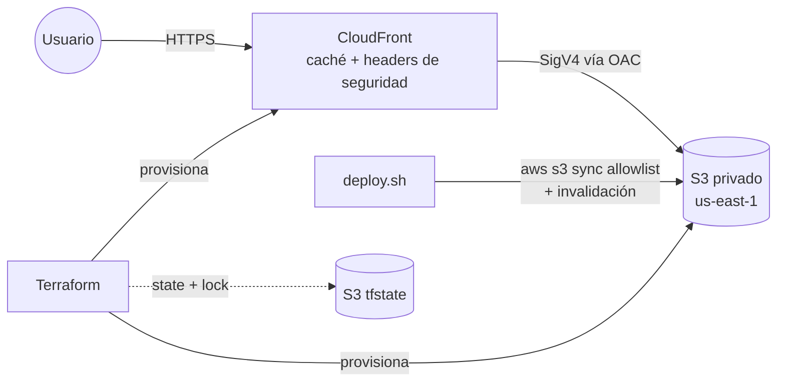

# ☁️ Portafolio Cloud: sitio estático seguro en AWS (S3 + CloudFront) con Terraform

[](https://d3aa0jlm30vgzc.cloudfront.net)
[](https://www.terraform.io/)
[](https://aws.amazon.com/s3/)

Mi portafolio profesional (PT / ES / EN), servido por CloudFront con HTTPS desde un bucket S3 privado y provisionado 100% con Terraform. Empezó como proyecto de práctica y hoy es la vitrina de mis proyectos de Cloud, IaC e IA generativa en AWS.

**🌐 Demo:** https://d3aa0jlm30vgzc.cloudfront.net

## 🏗️ Arquitectura



| Recurso Terraform | Función |
|---|---|
| `aws_s3_bucket` | Bucket con nombre único global |
| `aws_s3_bucket_public_access_block` | Bloquea todo acceso público: el bucket es privado |
| `aws_s3_bucket_policy` | `s3:GetObject` solo para `cloudfront.amazonaws.com`, limitado con `AWS:SourceArn` a esta distribución |
| `aws_cloudfront_origin_access_control` | OAC: CloudFront firma las peticiones a S3 con SigV4 |
| `aws_cloudfront_distribution` | HTTPS obligatorio (redirect 301), HTTP/2 y HTTP/3, caché `CachingOptimized`, headers de seguridad (HSTS, `nosniff`, `X-Frame-Options`), `index.html` como raíz y `error.html` para 403/404 |
| `aws_acm_certificate` + `aws_route53_record` (`acm.tf`) | Certificado y DNS del dominio propio. Solo se crean si `domain_name` no está vacío |

## 📁 Estructura

```
├── index.html        # Sitio (HTML + CSS + i18n PT/ES/EN, sin build)
├── error.html        # Página 404 personalizada
├── img/              # Foto, certificaciones, CV y fotos de comunidad (img/comunidad/*.webp)
├── bootstrap/        # Stack aparte (state local): bucket del state remoto
├── provider.tf       # Provider AWS (~> 5.0) + alias us-east-1, Terraform >= 1.10, backend S3
├── variables.tf      # bucket_name, aws_region, index_document, domain_name, price_class
├── main.tf           # Bucket privado, public access block, bucket policy (solo CloudFront)
├── cloudfront.tf     # OAC + distribución CloudFront
├── acm.tf            # Certificado ACM + Route 53 (solo con dominio propio)
├── outputs.tf        # website_url, cloudfront_domain, cloudfront_distribution_id, bucket_*
└── deploy.sh         # Deploy seguro (prod / preview / dry-run) + invalidación de CloudFront
```

## 🚀 Uso

```bash
# 0. Backend remoto (una sola vez)
cd bootstrap && terraform init && terraform apply && cd ..

# 1. Infraestructura
terraform init
terraform plan
terraform apply

# 2. Contenido
DRY_RUN=1 ./deploy.sh     # muestra qué subiría, sin tocar el bucket
./deploy.sh preview       # publica en s3://<bucket>/preview/ (abrir /preview/index.html)
./deploy.sh               # producción
```

`deploy.sh` toma el nombre del bucket de `terraform output` y sube **solo una allowlist** de archivos servibles. Así nunca se publican `terraform.tfstate`, `.terraform/` ni los `.tf`. El HTML se sube con `Cache-Control: no-cache` y los assets con 7 días de caché. Al final invalida `/*` en CloudFront (la ruta con comodín cuenta como una sola de las 1.000 gratuitas por mes).

Para agregar fotos de eventos: exportar a `.webp` (≈1200px de ancho) en `img/comunidad/` con el nombre que referencia `index.html` (`aws-ug-floripa.webp`, `escola-da-nuvem.webp`, `community-day-sul-2026.webp`). Si la foto no existe, la tarjeta muestra un placeholder.

### State remoto

El state del stack principal vive en `s3://danielvillegas-tfstate-2026/s3-website/terraform.tfstate`, con lock nativo de S3 (`use_lockfile = true`, sin DynamoDB). El bucket se crea desde `bootstrap/`, que usa state local porque no puede guardarse en el bucket que él mismo crea. Tiene versionado, cifrado SSE-S3, acceso público bloqueado, política que exige TLS y `prevent_destroy`.

## 🔍 Troubleshooting y aprendizajes

- **403 Access Denied:** S3 es privado por defecto. Hizo falta desactivar Block Public Access *y* agregar una bucket policy con `s3:GetObject`; con solo uno de los dos el sitio no carga.
- **Endpoint REST vs. endpoint website:** el endpoint website resuelve índice y 404 pero no admite OAC ni HTTPS. Con CloudFront + OAC el origen es el endpoint REST, y esas funciones se reemplazan con `default_root_object` y `custom_error_response`. Por eso `/preview/` necesita `/preview/index.html` explícito.
- **404 que llega como 403:** con el bucket privado y sin `s3:ListBucket`, S3 responde 403 a un objeto inexistente. CloudFront mapea 403 y 404 a `error.html` con código 404.
- **Migración sin caída:** primero se agregó CloudFront manteniendo la política pública (fase 1). Recién después de validar HTTPS, 404 y assets, se bloqueó el acceso público y se eliminó la configuración website (fase 2).
- **Imágenes dentro de un .zip:** el navegador no descomprime archivos; los assets tienen que subirse sueltos con la misma ruta que referencia el HTML.
- **Case sensitivity:** las keys de S3 distinguen mayúsculas, minúsculas y extensión (`.jpg` ≠ `.png`).
- **Del console a IaC:** el bucket se creó primero a mano y luego se migró a Terraform; el ARN hardcodeado en la policy se reemplazó por `aws_s3_bucket.portfolio.arn`.
- **AccessDenied con "explicit deny" al crear el bucket de state:** el usuario IAM tiene una política que niega todo sin MFA, y el perfil usado solo tenía claves fijas. Se resuelve con `aws sts get-session-token --serial-number <arn-mfa> --token-code <código>` y usando las credenciales temporales (con `aws_session_token`).
- **Migración local → S3:** `bootstrap/` crea el bucket con state local; después `terraform init -migrate-state` copia el state y `terraform plan` debe dar "No changes" antes de borrar el archivo local.
- **Deploy seguro:** un `aws s3 sync .` sin filtros publicaría el tfstate (que puede contener datos sensibles). Por eso el deploy usa una allowlist.

## 🗺️ Próximos pasos

- [x] CloudFront (HTTPS) con Origin Access Control y bucket privado
- [ ] Dominio propio con ACM + Route 53 (código listo en `acm.tf`; falta registrar el dominio)
- [ ] Deploy automático con GitHub Actions vía OIDC
- [x] Backend remoto de Terraform (S3 + lockfile)

## 👨‍💻 Autor

**Daniel Villegas**: Cloud Engineer · AWS Certified (4x) · Mentor en Escola da Nuvem · Leader del AWS User Group Florianópolis

[](https://www.linkedin.com/in/vdaniel07)
[](https://github.com/DevDan7)
